# Vanga

Vanga 是面向 Komga 媒体库的 Android 漫画 / 图书客户端。项目重点是稳定的本地阅读体验、中文界面、常用媒体库管理，以及与 Komga / Komf 生态的连接能力。

> 当前版本：`v1.1.1`
>
> Android 包名：`io.github.vivitoto.vanga`

## 功能概览

- 连接 Komga 服务器，浏览媒体库、系列、单本、合集与阅读清单。
- 内置图片阅读器，支持分页 / 连续阅读、阅读方向、缩放、拉伸适配、裁边和采样设置。
- 支持 EPUB 阅读入口。
- 支持阅读进度、收藏、下载状态、批量操作等常用管理能力。
- 支持 Komf 相关连接、处理任务、元数据提供方与通知配置。
- 提供 Android 构建目标。

## 截图

<details>
  <summary>手机端</summary>
   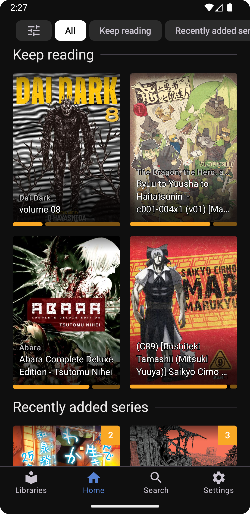
   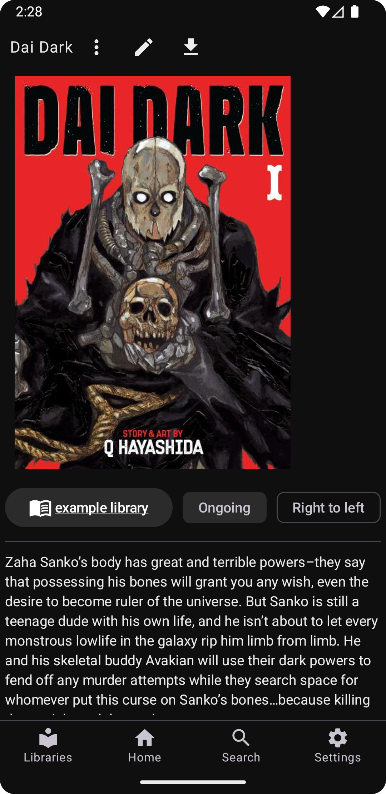
   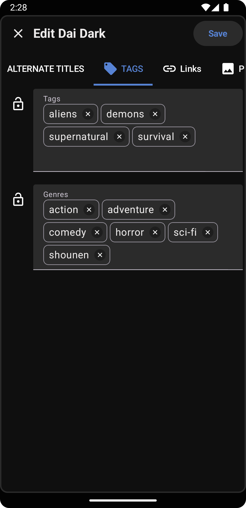
   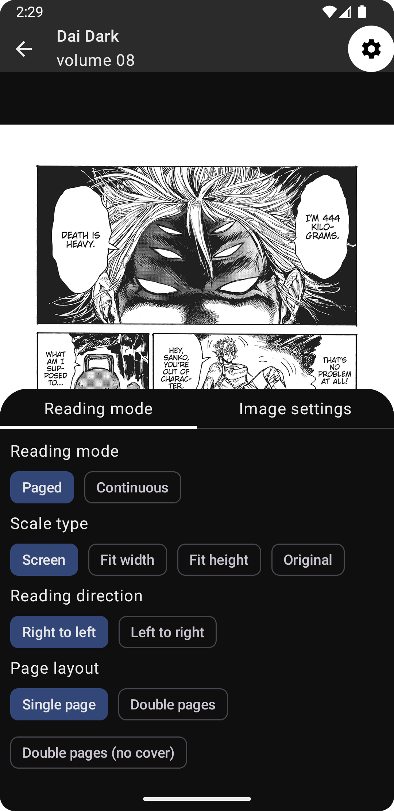
   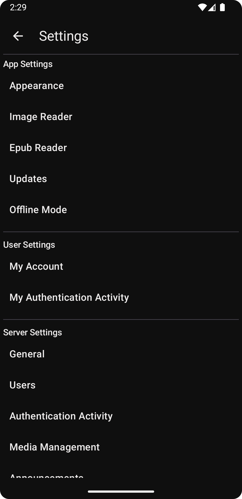
   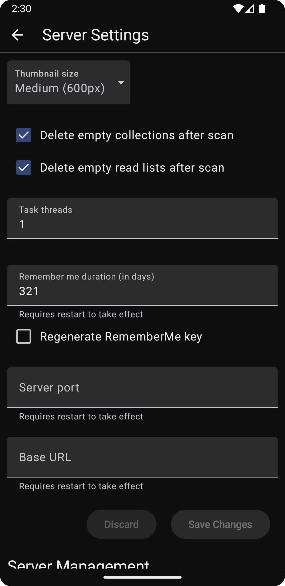
</details>

<details>
  <summary>平板端</summary>
   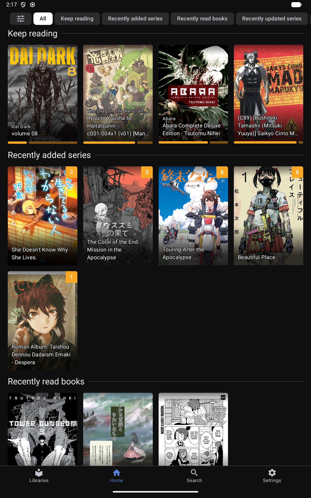
   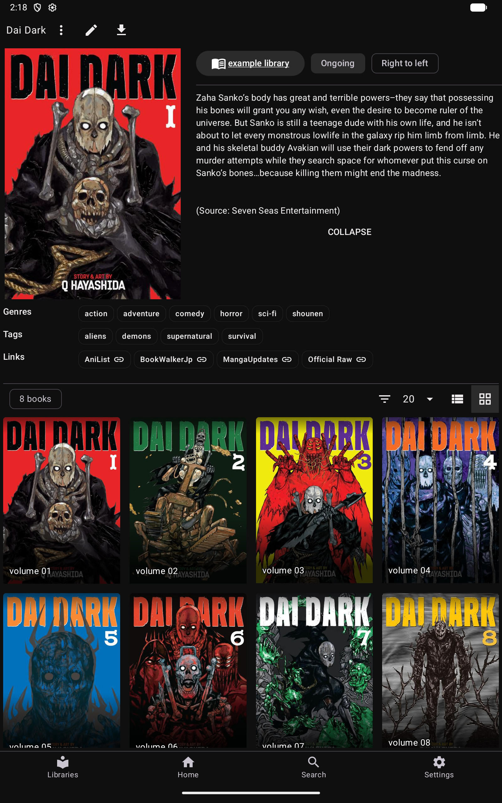
   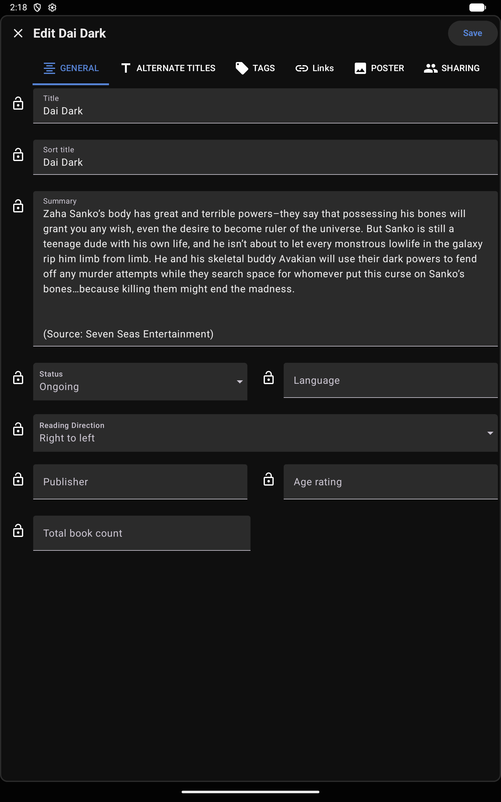
   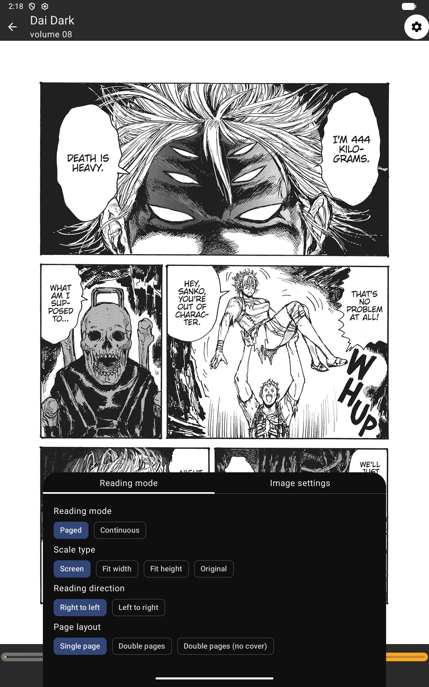
   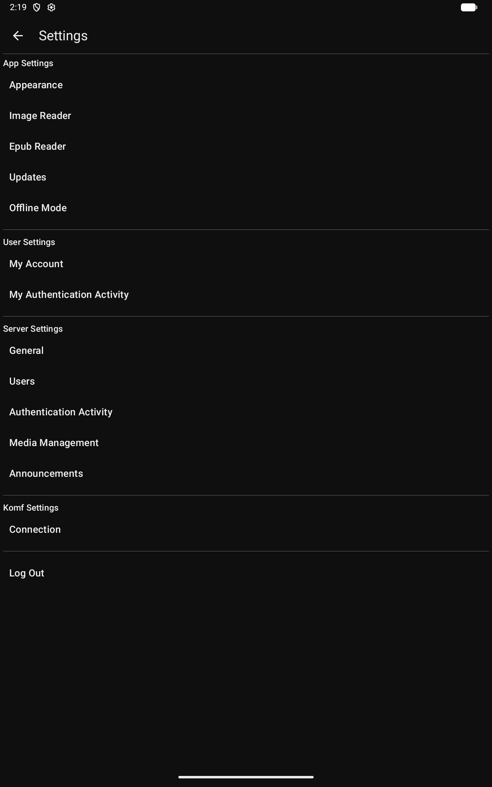
   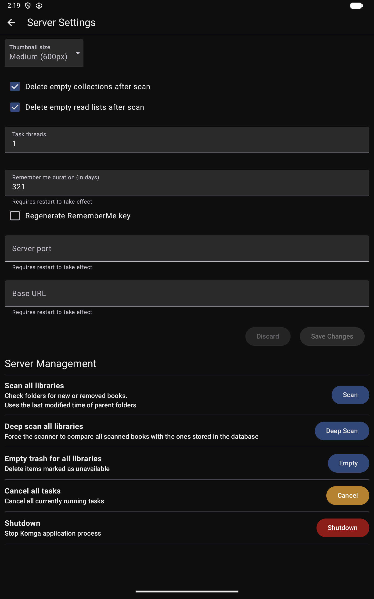
</details>


## 下载

当前推荐 APK 在 GitHub Release：

全部版本：https://github.com/Vivitoto/Vanga/releases

每次发布都会生成独立的 `vX.Y.Z` 版本存档，请下载对应该版本的 `vanga-vX_Y_Z.apk`。最新版在 Releases 页面顶部标记为 Latest。

## 构建说明

Android 目标需要 JDK 17 或更高版本。原生库构建需要 C / C++ 编译环境，EPUB 阅读器 WebUI 构建需要 Node.js。

推荐使用 `cmake/` 下提供的 Dockerfile 构建原生依赖；如果使用本机工具链，可在 Linux 上尝试：

```bash
./gradlew vangaBuildNonJvmDependencies
```

### Android

可用架构包括：`aarch64`、`armv7a`、`x86_64`、`x86`。

```bash
docker build -t vanga-build-android . -f ./cmake/android.Dockerfile
docker run -v .:/build vanga-build-android <arch>
./gradlew <arch>_copyJniLibs
./gradlew buildWebui
```

常用构建命令：

```bash
./gradlew :vanga-app:assembleDebug
./gradlew :vanga-app:assembleRelease
```
